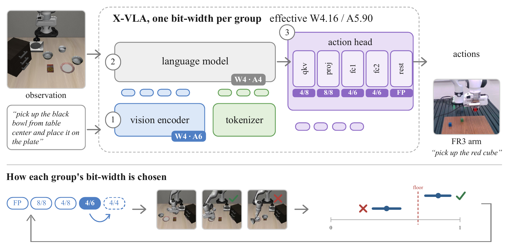
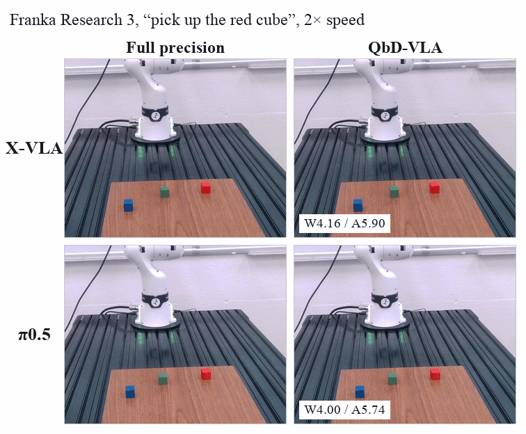
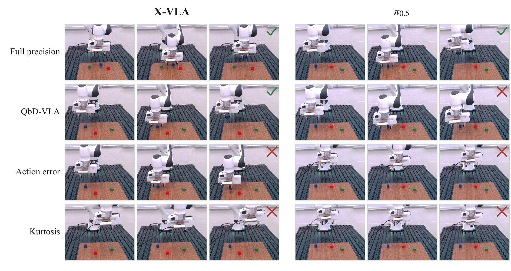

<div align="center">

# Quantize by Doing

### Task-Guided Mixed-Precision Quantization of Vision-Language-Action Models

**Jiuyi Xu**<sup>1</sup>, **Xiao Hu**<sup>2</sup>, **Meida Chen**<sup>3</sup>, **Song Wang**<sup>4</sup>, **Yang Ye**<sup>2</sup>, **Yangming Shi**<sup>1</sup>

<sup>1</sup>Colorado School of Mines &nbsp;&nbsp; <sup>2</sup>Northeastern University &nbsp;&nbsp; <sup>3</sup>USC Institute for Creative Technologies &nbsp;&nbsp; <sup>4</sup>University of Central Florida

<a href="#citation"></a>


</div>

<p align="center">
  
</p>

<p align="center"><em><b>QbD-VLA.</b> A group is lowered by one level, the policy is rolled out in simulation with every
other group at its current bit widths, and the move is kept only if its success estimate stays above the floor. The
search repeats until no move passes. The selected allocation (here X-VLA, W4.16 / A5.90) is deployed unchanged.</em></p>

QbD-VLA assigns weight and activation bit widths to the layer groups of a vision-language-action (VLA) policy from
**closed-loop task success** instead of a sensitivity score computed on calibration data. Starting from full precision,
it lowers one group by one level at a time (FP → W8A8 → W4A8 → W4A6 → W4A4) and scores each candidate in simulation
with every other group at its current bit widths, so the effect of a group is measured in the configuration it will
run in. Each candidate gets one to three batches of one episode per task, and a sequential test on Wilson bounds keeps
the move only if the success estimate stays above a floor relative to full precision. Quantization is round-to-nearest
without calibration, and no policy is trained.

## Results

### Simulation

Average success (%) over the four LIBERO suites. The QbD-VLA allocation is selected on LIBERO-Spatial and applied
unchanged to Object, Goal and Long; bits are parameter-weighted nominal values over all layer groups.

| Policy | Full precision | Uniform W4A4 | Uniform W4A6 | QbD-VLA | QbD-VLA bits (W / A) |
|---|---:|---:|---:|---:|---:|
| π0.5 | 96.8 | 0.0 | 96.5 | 96.2 | 4.00 / 5.74 |
| OpenVLA-OFT | 96.5 | 0.0 | 22.4 | 91.8 | 4.00 / 5.94 |
| X-VLA | 97.6 | 0.0 | 61.9 | 95.8 | 4.16 / 5.90 |
| π0 | 74.6 | 56.0 | 72.0 | 73.5 | 4.14 / 4.47 |

Sensitivity-based allocations (action error, activation kurtosis, reconstruction error) at the same cost reach 27.5,
0.0 and 52.0% on π0.5 LIBERO-Spatial, where QbD-VLA reaches 98.5%. On SIMPLER the best allocation reaches 66.8%
against 64.8% for uniform W4A6.

### Real robot

<p align="center">
  
</p>

X-VLA and π0.5 are fine-tuned with LoRA on 411 demonstrations of a Franka Research 3 arm picking up a cube of a named
colour, and the allocations selected on LIBERO-Spatial are deployed unchanged. For X-VLA the allocation succeeds on 13
of 30 trials (11 at full precision). For π0.5 it succeeds on none of six (six at full precision) and never commands the
gripper to close; the action-error and kurtosis allocations at the same cost also fail on all six, and uniform W8A8
succeeds on five. **Evaluate a selected configuration on the target robot and task before deploying it.**

<p align="center">
  
</p>

<p align="center"><em>Example trials of full precision, QbD-VLA, and the action-error and kurtosis allocations, three
frames per trial, for X-VLA (left) and π0.5 (right).</em></p>

The results video (LIBERO rollouts and FR3 trials, conditions side by side) is attached to the
[GitHub release](https://github.com/jiuyixu25/QbD-VLA/releases).

## Install

```bash
git clone https://github.com/jiuyixu25/QbD-VLA && cd QbD-VLA
pip install -e .                           # the package: torch, numpy, pyyaml, tqdm
python -m pytest -q tests                  # CPU unit tests

bash scripts/env/setup_lerobot.sh          # pi0, pi0.5 (LeRobot 0.5.2) + LIBERO
bash scripts/env/setup_openvla_oft.sh      # OpenVLA-OFT (moojink fork) + LIBERO
bash scripts/env/setup_xvla.sh             # X-VLA (clones the model code into third_party/X-VLA)
bash scripts/env/setup_simpler.sh          # SIMPLER, when the simulator is served separately
```

The policy stacks are mutually incompatible, so each script creates its own conda environment and installs this
package into it. Checkpoints are the released ones listed in `configs/models/*.yaml` and are downloaded on first use.
LIBERO runs need `MUJOCO_GL=egl`.

## Run an allocation

The command-line flags `--probe-*` set the short evaluation batches of Section 3.2. The defaults are the settings of
the paper: one episode per task from initial states 20 to 22 (`--probe-from 20`), at most three batches per candidate
(`--probe-blocks 3`), Wilson parameters 1.28 / 1.96, a minimum full-precision score of 0.5, and a cap of 6,000 newly
executed episodes (`--max-episodes 6000`). Cached batches are reused when a configuration recurs and do not count
toward the cap; a stopped run resumes from its cache.

```bash
qbdvla search --model pi05        --benchmark libero --suite libero_spatial --tau 0.75 --probe-horizon 120 --out search/pi05-spatial
qbdvla search --model openvla_oft --benchmark libero --suite libero_spatial --tau 0.90 --probe-horizon 120 --out search/oft-spatial
qbdvla search --model xvla        --benchmark libero --suite libero_spatial --tau 0.90 --probe-horizon 300 --out search/xvla-spatial
qbdvla search --model pi0         --benchmark libero --suite libero_spatial --tau 0.90 --probe-horizon 120 --out search/pi0-spatial

# SIMPLER, X-VLA: 24 tasks at tau 0.90, or 40 tasks at tau 0.95
qbdvla search --model xvla --benchmark simpler --suite google_robot_va --probe-tasks 24 --tau 0.90 --probe-horizon 120 --out search/xvla-simpler-va
```

`search/<run>/result.json` holds the settings, the groups with their parameter counts, every accepted configuration
with its short-batch estimate, and the selected configuration (`selected.levels`); `probes.jsonl` caches every
short-batch evaluation. `--groups coarse` (one group per component), `--no-retry`, `--probe-horizon 60`, `--tau` and
`--act-calib` give the protocol ablations.

## Evaluate a configuration

Every reported LIBERO cell uses initial states 0 to 19 of every task (200 episodes) with the official horizon of each
policy; SIMPLER cells use the 864 episodes of the visual-matching split.

```bash
# a group-level configuration, here the pi0.5 allocation; --suite libero_object / libero_goal / libero_10 give the
# transfer cells with the same configuration
python scripts/verify_config.py --model pi05 --suite libero_spatial --episodes 20 \
    --config '{"ve": "W4A6", "llm": "W4A6", "ah_attn": "W4A4", "ah_adarms_in": "W4A6", "ah_adarms_post": "W4A4", "ah_mlp": "W4A4", "ah_plumbing": "W4A4"}' \
    --out results/libero/libero_spatial/pi05/qbd-final.jsonl

# full precision and uniform cells
qbdvla run --model pi05 --benchmark libero --suite libero_spatial --preset BASELINE --episodes 20
qbdvla run --model pi05 --benchmark libero --suite libero_spatial --preset W4A6 --scope e2e --episodes 20

# sensitivity-based allocations at the cost of the selected configuration (W + A = 9.74 for pi0.5),
# then verify_config.py on each configuration in baselines.json
qbdvla baselines --model pi05 --benchmark libero --suite libero_spatial --target-sum 9.74 --out search/pi05-spatial-baselines

# UFR: uniform descent, then single-group relaxation, with the same batches and test
python scripts/uniform_floor_relax.py --model pi05 --suite libero_spatial --tau 0.75 --horizon 120 --out search/pi05-ufr
```

Every run writes `results/<benchmark>/<suite>/<model>/<tag>.jsonl`: a header with the model, checkpoint,
configuration and nominal bits, then one record per episode with task, initial state, success, steps and latency.
`qbdvla summarize results/` aggregates a directory of such files.

## Reproduce the tables

```bash
python tables/make_tables.py               # standard library only; writes tables/generated/
```

[`records/`](records/README.md) holds every evaluation cell and allocation run behind the simulation results; the script
regenerates Tables 1, 2, 3, 4 and 7, the group-interaction numbers quoted in the text, and a per-cell summary
(`cells.csv`) from them.

## Repository layout

```
qbdvla/
  search/greedy.py       the allocation: one group one level at a time, short closed-loop batches, a sequential test on
                         Wilson bounds against a relative floor, rejected moves retried after every accept, and the
                         operating-point rule (select_point)
  search/space.py        the layer groups of each policy (MODEL_GROUPS), the levels FP / W8A8 / W4A8 / W4A6 / W4A4,
                         and the nominal cost of a configuration
  search/probe.py        the short batches: one episode per task from held-out initial states, shortened horizon
  search/baselines.py    sensitivity-based allocators: action error, activation kurtosis, reconstruction error (Table 3)
  quant/                 round-to-nearest weight and activation quantization, presets, in-place application; act_calib.py
                         is the activation calibration used only by the calibrated cells
  components.py          vision encoder / projector / language backbone / action head decomposition of a policy
  models/                adapters: pi0 and pi0.5 (LeRobot), OpenVLA-OFT, X-VLA; openpi_ws.py is the client used to
                         evaluate the ActQuant runtime
  benchmarks/            LIBERO and SIMPLER runners: official task lists, initial states, horizons, metric
  results.py             the record format (one header, then one line per episode)
  remote.py              policy server and client, for a policy and a simulator in different environments
  cli.py                 the `qbdvla` command
scripts/
  verify_config.py       evaluates one group-level configuration under the official protocol (every mixed-precision cell)
  uniform_floor_relax.py the two-stage allocator UFR of Table 3
  path_verification.py   short-batch decision against full-protocol success along an accepted path (Section 4.4)
  env/                   environment setup per policy family, pinned to the upstream commits that were used
configs/
  models/*.yaml          official checkpoints and baseline precision per policy
  simpler/*.json         the official SIMPLER task tables
tests/                   unit tests of the quantizer, the group logic, the records and the allocation (CPU only)
tables/make_tables.py    regenerates the paper's tables from records/
records/                 every evaluation cell and allocation run behind the simulation results
```

QbD-VLA builds on [VLAQuantBench](https://github.com/jiuyixu25/VLAQuantBench) ([arXiv:2609.25376](https://arxiv.org/abs/2609.25376)):
the round-to-nearest quantizer, the component decomposition, the policy adapters and the benchmark runners follow its
closed-loop protocol, and the layer groups are its group definitions.

## Citation

```bibtex
@misc{xu2026qbdvla,
  title  = {Quantize by Doing: Task-Guided Mixed-Precision Quantization of Vision-Language-Action Models},
  author = {Xu, Jiuyi and Hu, Xiao and Chen, Meida and Wang, Song and Ye, Yang and Shi, Yangming},
  year   = {2026},
  note   = {arXiv preprint}
}
```

See also [`CITATION.cff`](CITATION.cff). Released under the [MIT License](LICENSE).
